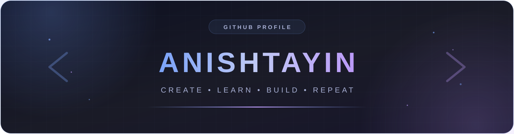
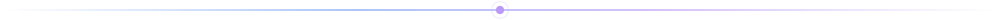

<div align="center">
  

  <a href="https://git.io/typing-svg">
    
  </a>

  <p>
    <a href="https://github.com/AnishtayiN">
      
    </a>
    <a href="https://github.com/AnishtayiN?tab=followers">
      
    </a>
    
  </p>
</div>

## Hey, I’m AnishtayiN

Welcome to my corner of GitHub. I enjoy turning ideas into useful digital experiences, exploring new technologies, and improving a little every day. This profile brings together my projects, experiments, and learning journey.

```js
const anishtayin = {
  mindset: ["curious", "consistent", "creative"],
  focus: "Building clean and practical solutions",
  currently: "Learning, creating, and improving",
  openTo: ["Interesting projects", "Collaboration", "New connections"],
  motto: "Create. Learn. Build. Repeat."
};
```

<div align="center">
  
</div>

## Tech & Tools

A selection of technologies and tools I use and explore.

<div align="center">
  
</div>

<div align="center">
  
</div>

## GitHub at a Glance

<div align="center">
  
  
</div>

<div align="center">
  
</div>

## Contribution Activity

<div align="center">
  
</div>

## Achievements

<div align="center">
  
</div>

<div align="center">
  
</div>

## Let’s Connect

Have an interesting idea or just want to say hello? Explore my work and connect with me on GitHub.

<div align="center">
  <a href="https://github.com/AnishtayiN?tab=repositories">
    
  </a>
  <a href="https://github.com/AnishtayiN">
    
  </a>
</div>

<br />

<div align="center">
  <strong>Thanks for stopping by.</strong>
  <br />
  <sub>Feel free to explore, follow, and connect.</sub>
</div>


<!-- Personalize this profile further by adding your portfolio, LinkedIn, and email when you are ready. -->
